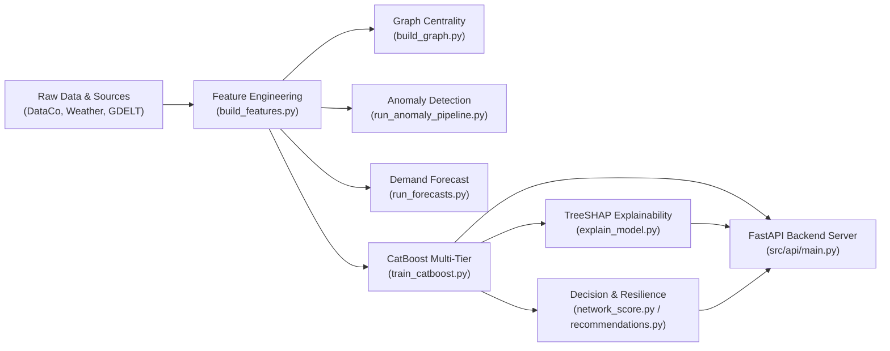

# AI-Driven Supply Chain Risk Prediction and Resilience Management Platform

Predicts four operational risks across a multi-tier smartphone supply chain 7 days in advance, classifies each risk tier into discrete severity levels (`LOW` / `MEDIUM` / `HIGH`), generates TreeSHAP feature attributions for root-cause explainability, and recommends deterministic resilience mitigation playbooks.

- **Risk Domains:** Supplier Failure, Manufacturing Delay, Warehouse Stockout, Transport Disruption
- **Entity Scope:** 27 Physical Network Nodes (8 Suppliers, 4 Plants, 5 Warehouses, 10 Logistics Corridors)
- **Time Window:** 1 April 2025 to 31 October 2025 (214 simulation days)
- **Temporal Splitting:** Leak-free purge-gap splits:
  - **Train:** 2025-04-01 to 2025-08-24
  - **Purge Gap 1:** 2025-08-25 to 2025-08-31
  - **Validation:** 2025-09-01 to 2025-09-23
  - **Purge Gap 2:** 2025-09-24 to 2025-09-30
  - **Test (Held-out):** 2025-10-01 to 2025-10-24
  - **Unobserved:** 2025-10-25 to 2025-10-31 (Strictly NaN lookahead labels)

---

## Verified System Architecture



---

## Setup & Installation

### Environment Setup
```bash
py -3 -m venv .venv
# Windows:
.venv\Scripts\activate
# Linux/macOS:
source .venv/bin/activate

pip install -r requirements.txt
pip install catboost scikit-learn shap statsmodels
```

---

## Pipeline Execution & Reproduction

Run each pipeline stage in sequence using standard Python module execution:

```bash
# 1. Feature Engineering & Temporal Leak-Free Splitting
py -3 -m src.data.build_features

# 2. Structural Graph Centrality (PageRank & Reach)
py -3 -m src.graph.build_graph

# 3. Anomaly Detection (Extended Isolation Forest vs Baseline IF)
py -3 -m src.anomaly.run_anomaly_pipeline

# 4. Warehouse Demand Forecasting (Holt-Winters Exponential Smoothing)
py -3 -m src.forecast.run_forecasts

# 5. Multi-Tier CatBoost Training & Prediction Across 27 Entities
py -3 -m src.stacking.train_catboost

# 6. TreeSHAP Attribution & Top-3 Diagnostic Drivers
py -3 -m src.stacking.explain_model

# 7. Model Evaluation Comparison (Held-out Test Split)
py -3 -m src.anomaly.evaluate_metrics

# 8. Run All Unit & Pipeline Integrity Tests
py -3 -m pytest tests/

# 9. Start FastAPI REST Backend Server (Port 8000)
py -3 -m uvicorn src.api.main:app --host 0.0.0.0 --port 8000
```

---

## Validated Test Split Performance

Performance evaluated on the held-out October test split (2025-10-01 to 2025-10-24) across 27 network entities:

| Model / Pipeline | Risk Type | Test PR-AUC | Test Recall | Test F1 | Status |
|---|---|:---:|:---:|:---:|:---:|
| **CatBoost Multi-Tier** | Supplier Failure | **0.527** | **1.000** | **0.077** | Verified Deployed |
| Plain CatBoost Baseline | Supplier Failure | 0.596 | 0.630 | 0.552 | Baseline Comparison |
| XGBoost Baseline | Supplier Failure | 0.517 | 0.422 | 0.371 | Baseline Comparison |
| **CatBoost Multi-Tier** | Manufacturing Delay | **0.120** | **0.286** | **0.114** | Verified Deployed |
| Plain CatBoost Baseline | Manufacturing Delay | 0.742 | 0.362 | 0.693 | Baseline Comparison |
| XGBoost Baseline | Manufacturing Delay | 0.494 | 0.568 | 0.501 | Baseline Comparison |
| **CatBoost Multi-Tier** | Warehouse Stockout | **0.065** | **0.857** | **0.130** | Verified Deployed |
| Plain CatBoost Baseline | Warehouse Stockout | 0.506 | 0.752 | 0.417 | Baseline Comparison |
| XGBoost Baseline | Warehouse Stockout | 0.466 | 0.464 | 0.381 | Baseline Comparison |
| **CatBoost Multi-Tier** | Transport Disruption | **0.038** | **0.000** | **0.000** | Verified Deployed |
| Plain CatBoost Baseline | Transport Disruption | 0.774 | 0.734 | 0.387 | Baseline Comparison |
| XGBoost Baseline | Transport Disruption | 0.411 | 0.565 | 0.380 | Baseline Comparison |
| **Extended Isolation Forest** | Supplier Failure | **1.000** | **1.000** | **0.130** | Verified Anomaly |
| Plain Isolation Forest | Supplier Failure | 1.000 | 1.000 | 0.080 | Baseline Comparison |
| **Extended Isolation Forest** | Transport Disruption | **1.000** | **1.000** | **1.000** | Verified Anomaly |
| Plain Isolation Forest | Transport Disruption | 0.743 | 0.032 | 0.061 | Baseline Comparison |

---

## FastAPI REST Endpoints

| Endpoint | Method | Parameters | Description |
|---|---|---|---|
| `/api/risks` | `GET` | `date`, `risk_type` | Returns 7-day predicted probabilities & discrete risk levels across all 27 entities (5,778 total records). |
| `/api/reasons` | `GET` | `entity_id`, `risk_type` | Returns top-3 diagnostic drivers and exact TreeSHAP feature attributions for root-cause diagnosis. |
| `/api/network-score` | `GET` | `date` | Computes holistic composite network risk score (0–100%) weighted across all 5 operational components. |
| `/api/alerts` | `GET` | `entity_id` | Prescriptive resilience mitigation actions and human-readable operational summaries. |
| `/api/metrics` | `GET` | None | Returns 22 test evaluation comparison rows (PR-AUC, Recall, F1) between baseline and upgraded models. |
| `/api/forecast` | `GET` | None | Warehouse demand forecasts and demand surge flags. |
| `/api/anomalies` | `GET` | None | Isolation Forest multi-tier operational anomaly detections. |

---

## Repository Structure

```
├── data/
│   ├── raw/               # Downloaded DataCo, weather, and GDELT raw parquet files
│   ├── synthetic/         # Generated supply chain ground truth tables
│   └── processed/         # Leak-free parquet feature tables (features_*_v1/v2.parquet)
├── docs/                  # API contract, schemas, labels, and architectural assumptions
├── models/                # Trained CatBoost binary classifiers (*.cbm) & metadata JSON
├── outputs/               # 27-entity predictions.csv, metrics.csv, shap_values.parquet, reasons.csv
├── src/
│   ├── data/              # Feature engineering & temporal split logic
│   ├── graph/             # NetworkX supply chain bipartite graph analysis
│   ├── nlp/               # GDELT news risk scoring & sentiment analysis
│   ├── anomaly/           # Extended Isolation Forest anomaly detection
│   ├── forecast/          # Warehouse demand forecasting
│   ├── stacking/          # CatBoost multi-tier training & TreeSHAP explainability
│   ├── decision/          # Composite network score & prescriptive recommendations
│   └── api/               # FastAPI REST service & endpoint verification
└── tests/                 # Full unit & end-to-end integration test suite
```
