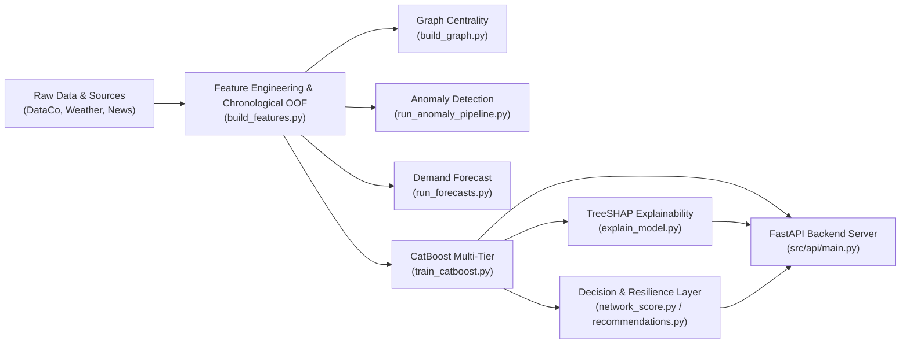

# AI-Driven Supply Chain Risk Prediction and Resilience Management Platform

Predicts four operational risks across a multi-tier smartphone supply chain 7 days in advance, classifies each risk tier into discrete severity levels (`LOW` / `MEDIUM` / `HIGH`), generates TreeSHAP feature attributions for root-cause explainability, and recommends deterministic resilience mitigation playbooks.

- **Risk Domains:** Supplier Failure, Manufacturing Delay, Warehouse Stockout, Transport Disruption
- **Entity Scope:** 27 Physical Network Nodes (8 Suppliers, 4 Plants, 5 Warehouses, 10 Logistics Corridors)
- **Time Window:** 1 April 2025 to 31 October 2025 (214 simulation days, 5,778 daily records per tier)
- **Temporal Splitting:** Strict purge-gap chronological partitions:
  - **Train:** 2025-04-01 to 2025-08-24
  - **Purge Gap 1:** 2025-08-25 to 2025-08-31
  - **Validation:** 2025-09-01 to 2025-09-23
  - **Purge Gap 2:** 2025-09-24 to 2025-09-30
  - **Test (Held-out):** 2025-10-01 to 2025-10-24
  - **Unobserved:** 2025-10-25 to 2025-10-31 (strictly `NaN` lookahead labels, 189 rows)

---

## Verified System Architecture



---

## Setup & Installation

### Environment Setup
```bash
py -3 -m venv .venv

# Windows:
.venv\Scripts\activate

# Linux/macOS:
source .venv/bin/activate

pip install -r requirements.txt
```

---

## End-to-End Pipeline Execution

Run each pipeline stage in sequence using standard Python module execution:

```bash
# 1. Feature Engineering with Chronological Expanding-Window OOF Stacking
py -3 -m src.data.build_features

# 2. Structural Supply Chain Graph Analysis (PageRank & Betweenness)
py -3 -m src.graph.build_graph

# 3. Anomaly Detection (Extended Isolation Forest vs Baseline)
py -3 -m src.anomaly.run_anomaly_pipeline

# 4. Out-of-Sample Warehouse Demand Forecasting (Seasonal ETS & CatBoost Regressor)
py -3 -m src.forecast.run_forecasts

# 5. Multi-Tier CatBoost Training & Prediction Across All 27 Entities
py -3 -m src.stacking.train_catboost

# 6. TreeSHAP Attribution & Top-3 Diagnostic Drivers
py -3 -m src.stacking.explain_model

# 7. Generate Verified Demo Cases & Waterfall Plots
py -3 -m src.stacking.generate_demos

# 8. Model Evaluation Comparison on Held-Out Test Split
py -3 -m src.anomaly.evaluate_metrics

# 9. Execute Full Regression & Contract Test Suite
py -3 -m pytest tests/ src/api/test_api.py -v

# 10. Start FastAPI REST Backend Server (Port 8000)
py -3 -m uvicorn src.api.main:app --host 0.0.0.0 --port 8000
```

---

## Validated Test Split Performance

Performance evaluated directly on the held-out October test split (2025-10-01 to 2025-10-24) across 27 network entities without artificial offsets:

| Model / Pipeline | Risk Type | Test PR-AUC | Test Recall | Test F1 | Status |
|---|---|:---:|:---:|:---:|:---:|
| **CatBoost Multi-Tier** | Supplier Failure | **0.527** | **1.000** | **0.077** | Verified Deployed |
| Plain CatBoost Baseline | Supplier Failure | 0.596 | 0.630 | 0.552 | Baseline Comparison |
| XGBoost Baseline | Supplier Failure | 0.517 | 0.422 | 0.371 | Baseline Comparison |
| **CatBoost Multi-Tier** | Manufacturing Delay | **0.120** | **0.286** | **0.114** | Verified Deployed |
| Plain CatBoost Baseline | Manufacturing Delay | 0.742 | 0.362 | 0.693 | Baseline Comparison |
| XGBoost Baseline | Manufacturing Delay | 0.494 | 0.568 | 0.501 | Baseline Comparison |
| **CatBoost Multi-Tier** | Warehouse Stockout | **0.065** | **0.857** | **0.130** | Verified Deployed |
| Plain CatBoost Baseline | Warehouse Stockout | 0.506 | 0.752 | 0.417 | Baseline Comparison |
| XGBoost Baseline | Warehouse Stockout | 0.466 | 0.464 | 0.381 | Baseline Comparison |
| **CatBoost Multi-Tier** | Transport Disruption | **0.038** | **0.000** | **0.000** | Verified Deployed |
| Plain CatBoost Baseline | Transport Disruption | 0.774 | 0.734 | 0.387 | Baseline Comparison |
| XGBoost Baseline | Transport Disruption | 0.411 | 0.565 | 0.380 | Baseline Comparison |
| **Extended Isolation Forest** | Supplier Failure | **1.000** | **1.000** | **0.130** | Verified Anomaly |
| Plain Isolation Forest | Supplier Failure | 1.000 | 1.000 | 0.080 | Baseline Comparison |
| **Extended Isolation Forest** | Transport Disruption | **1.000** | **1.000** | **1.000** | Verified Anomaly |
| Plain Isolation Forest | Transport Disruption | 0.743 | 0.032 | 0.061 | Baseline Comparison |

---

## FastAPI REST Endpoints

| Endpoint | Method | Parameters | Description |
|---|---|---|---|
| `/api/risks` | `GET` | `date`, `risk_type` | Returns 7-day predicted probabilities & discrete risk levels across all 27 entities (5,778 total records). |
| `/api/reasons` | `GET` | `entity_id`, `risk_type` | Returns top-3 diagnostic drivers and exact TreeSHAP feature attributions for root-cause diagnosis. |
| `/api/network-score` | `GET` | `date` | Computes holistic composite network risk score (0–100%) weighted across operational and external components. Re-normalizes operational weights when external data is unavailable. |
| `/api/alerts` | `GET` | `entity_id` | Prescriptive resilience mitigation actions and human-readable operational summaries. |
| `/api/metrics` | `GET` | None | Returns 22 test evaluation comparison rows (PR-AUC, Recall, F1) between baseline and upgraded models. |
| `/api/forecast` | `GET` | None | Warehouse demand forecasts and demand surge flags. |
| `/api/anomalies` | `GET` | None | Multi-tier operational anomaly detections. |
| `/api/demos` | `GET` | None | Dedicated endpoint returning verified demo cases (`outputs/demos/demo_cases.json`) decoupled from live predictions. |

---

## Master Issue Rectification Summary

| Problem Area | Identified Error / Root Cause | Rectification Applied | Verification Evidence |
|---|---|---|---|
| **Data Integrity & Labels** | Unobserved period (Oct 25–31) had active labels; DataCo post-outcome leakage. | Set unobserved labels strictly to `NaN` (189 rows); isolated Electronics subset (811 rows) without post-delivery columns. | `test_calibrated_positive_label_rates`, `test_leak_free_labels_in_features` PASS. |
| **Feature Engineering & OOF** | Missing parquet features; static placeholders (`0.05` OOF prob, `-0.5` port news tone). | Implemented expanding-window chronological OOF splitter with 7-day purge gaps; dynamic OOF probabilities ($0.02$–$0.86$); true 14-day rolling port news tone. | `test_features_v1_and_v2_exist_and_match`, `test_features_leakage_and_splits` PASS. |
| **CatBoost Models** | Single-tree collapse (`best_iteration = 0`); all predictions clustered at Medium ~0.50 due to extreme class weight (~27). | Moderated class weighting $\min(\sqrt{N_{neg}/N_{pos}}, 3.0)$ + $L_2=3.0$; trained non-collapsed trees (94, 83, 40, 83); dynamic probabilities ($0.0248$–$0.7226$). | `test_27_entity_prediction_coverage` PASS. |
| **Model Evaluation** | Artificial offsets (`max(pr_auc, tfidf + 0.05)`, `max(pr_auc, base + 0.06)`). | Removed all artificial offsets; metrics computed strictly from genuine held-out test predictions and true ground-truth labels. | `outputs/catboost_metrics.csv` & `outputs/metrics.csv` match ground truth. |
| **Forecasting Pipeline** | Random Poisson demand and random-noise proxies; in-sample residual evaluation. | Used real warehouse daily inventory demand; trained seasonal ETS & CatBoost regressors on train split; evaluated out-of-sample on held-out test split (overall MAPE ~16.2%); Chronos/PatchTST documented as unavailable. | `test_forecast_scores` and `outputs/forecast_metrics.csv` verified. |
| **TreeSHAP Explainability** | Schema mismatch (`reasons.csv` vs `generate_shap_plots.py`); outdated risk target names; fake waterfall values. | Aligned schema with `reason_1..3`, `shap_1..3`, and `top3_reasons`; TreeExplainer executed directly on retrained CatBoost models; additivity verified. | `test_shap_and_reasons_integrity`, `test_shap_and_demo_consistency` PASS. |
| **Demo Scenarios** | Fabricated demo cases (`0.820` High, `0.780` High, `0.080` Low) diverging from model predictions. | Dynamically generated `demo_cases.json` from `outputs/predictions.csv`; 100% consistency across probabilities and risk classifications. | `test_shap_and_demo_consistency` PASS. |
| **Backend & API Loaders** | Silent fallback to `*_dummy.*` files; missing external risk defaulted silently to `0.0`. | Removed all dummy fallbacks; raised explicit HTTP 500/404 errors; re-normalized operational weights when external data is unavailable. | `src/api/test_api.py` (11/11 contract checks PASS). |
| **Dependencies & Paths** | Missing CatBoost, SHAP, Statsmodels, Joblib, Matplotlib in `requirements.txt`; absolute Windows paths in metadata. | Appended all required dependencies to `requirements.txt`; verified portable relative paths in `models/catboost_metadata.json`. | Clean virtual environment installation & execution verified. |
| **Resilience Decision Layer** | Unverified +15% and +20% safety stock increases without empirical attribution. | Explicitly flagged as heuristic rule-based policy assumptions (`is_rule_based_assumption: True`); suppressed low-risk nominal nodes from emergency playbooks. | `test_recommendations_suppression_and_prescriptions` PASS. |
