# AI-Driven Supply Chain Management: Risk Prediction & Resilience Management Platform

[](https://www.python.org/)
[](https://fastapi.tiangolo.com)
[](https://react.dev)
[](https://catboost.ai/)
[]()
[](LICENSE)

An enterprise-grade predictive intelligence and operational resilience platform for multi-echelon global supply chains. The system forecasts four operational risk types across a 27-node network **7 days in advance** ($t+1$ to $t+7$), classifies risk severity (`LOW` / `MEDIUM` / `HIGH`), attributes root causes using TreeSHAP, tracks overall network fragility via a dynamic Resilience Score ($0-100$), and prescribes deterministic mitigation playbooks.

---

## Key Highlights

- **Predictive Horizon**: 7-day lookahead binary classification ($t+1$ to $t+7$), enabling proactive freight rerouting and buffer reallocation rather than reactive firefighting.
- **Physical Network Scope**: 27 Physical Network Facilities across 4 Tiers:
  - **Tier 1 (Suppliers - 8 nodes)**: Specialized silicon, substrate, and raw material fabricators (`SUP001` .. `SUP008`).
  - **Tier 2 (Manufacturing - 4 nodes)**: Regional device assembly and testing plants (`PLT001` .. `PLT004`).
  - **Tier 3 (Warehouses - 5 nodes)**: Central fulfillment centers and distribution hubs (`WH001` .. `WH005`).
  - **Tier 4 (Transport Corridors - 10 routes)**: Multimodal air, sea, and overland transit routes (`RT001` .. `RT010`).
- **Temporal Window**: 1 April 2025 to 31 October 2025 (214 simulation days, 5,778 daily records per operational tier).
- **Leakage-Free Temporal Protocol**:
  - All rolling indicators lagged by 1 day (`shift(1)`).
  - Chronological partitions with strict 7-day purge gaps between train, validation, and test sets.
  - Unobservable boundary window (25–31 October 2025) strictly set to `NaN` (189 rows).
  - DataCo post-outcome leakage variables (`Late_delivery_risk`, `delivery_status`) excluded.
- **Multimodal Data Integration**: Internal daily operational logs, historical DataCo supply chain transactions, Open-Meteo ERA5 atmospheric weather reanalysis, and GDELT geopolitical news tone.
- **Tree Non-Collapse Optimization**: Moderated square-root class weighting ($\min(\sqrt{N_{neg}/N_{pos}}, 3.0)$) and $L_2$ leaf regularization ($\lambda = 3.0$), preventing early-stopping tree collapse on rare disruption events (~3.6% positive rate).
- **Explainable AI (XAI)**: Polynomial-time TreeSHAP feature attributions and automated extraction of top-3 diagnostic disruption drivers.
- **Resilience Decision Layer**: Dynamic Network Resilience Score ($0-100$) weighted by graph centrality (PageRank & Betweenness) with automated weight re-normalization during telemetry outages.
- **Full-Stack Delivery**: Production ASGI FastAPI REST backend accompanied by a responsive React 19 + Tailwind CSS Executive Control Tower dashboard.

---

## System Architecture

```mermaid
flowchart TD
    subgraph Ingestion ["1. Data Acquisition & Preprocessing"]
        D1["DataCo Logistics (Electronics)"]
        D2["Open-Meteo ERA5 Weather API"]
        D3["GDELT News Sentiment & NLP"]
        D4["Operational Facility Logs"]
    end

    subgraph FeatureEngineering ["2. Temporal Feature Store & Topology"]
        F1["Leak-Free Lagged Features (shift(1))"]
        F2["NetworkX DAG (Betweenness & PageRank)"]
        F3["Chronological Purge-Gap Splitter"]
    end

    subgraph AnalyticsEngine ["3. Predictive & Unsupervised Modeling"]
        M1["Extended Isolation Forest (Anomaly Score)"]
        M2["Holt-Winters ETS (Demand Forecast)"]
        M3["Multi-Tier CatBoost Classifiers (4 Tiers)"]
        M4["Expanding-Window OOF Stacking"]
    end

    subgraph DecisionLayer ["4. Explainability & Resilience Management"]
        X1["TreeSHAP Exact Attributions (shap_values.parquet)"]
        X2["Top-3 Diagnostic Drivers (reasons.csv)"]
        X3["Dynamic Network Resilience Score (0-100)"]
        X4["Prescriptive Mitigation Playbooks"]
    end

    subgraph ServingLayer ["5. Serving & User Interface"]
        API["FastAPI REST Server (Port 8000)"]
        UI["React 19 Executive Dashboard (Port 5173)"]
    end

    Ingestion --> FeatureEngineering
    FeatureEngineering --> AnalyticsEngine
    AnalyticsEngine --> DecisionLayer
    DecisionLayer --> API
    API --> UI
```



---

## Repository Structure

```
AI-DRIVEN-SUPPLY-CHAIN-MANAGEMENT/
├── data/
│   ├── raw/                 # Open-Meteo weather, GDELT headlines, raw source data
│   ├── processed/           # Leak-free parquet feature tables (v1 & v2), graph scores
│   └── synthetic/           # Master tables (suppliers, plants, warehouses, routes)
├── docs/                    # Data dictionary, API contracts, architectural assumptions
├── frontend/                # React 19 + Vite + Tailwind CSS Executive Control Tower
│   ├── src/                 # Dashboard components, views, and state management
│   └── dist/                # Production build artifacts
├── models/                  # Serialized CatBoost binaries (*.cbm) & training metadata
├── outputs/                 # Predictions, TreeSHAP parquets, diagnostic reasons, demo scenarios
├── src/
│   ├── anomaly/             # Extended Isolation Forest & anomaly evaluation pipelines
│   ├── api/                 # FastAPI REST server & endpoint schemas (main.py, test_api.py)
│   ├── data/                # Data download, synthetic event generators, feature pipelines
│   ├── decision/            # Network Resilience Score & prescriptive recommendations
│   ├── forecast/            # Holt-Winters ETS & demand forecasting engines
│   ├── graph/               # NetworkX bipartite graph construction & centrality metrics
│   ├── nlp/                 # GDELT headline ingestion, NER entity linking, DeBERTa risk scoring
│   └── stacking/            # Multi-tier CatBoost training, TreeSHAP explainer, demo generator
├── tests/                   # Pytest automated test suites (data ingestion, features, decision engine)
├── .env.example             # Template environment variables
├── requirements.txt         # Pinned Python package dependencies
└── README.md                # Master project documentation
```

---

## Data Splits & Leakage Prevention Protocol

Data is partitioned strictly chronologically to mirror real-world production forecasting. Adjacent partitions are separated by **7-day purge gaps** matching the prediction horizon to prevent temporal label overlap.

```
[──── TRAIN SPLIT ────] [Purge 1] [── VALIDATION ──] [Purge 2] [──── HELD-OUT TEST ────] [Unobserved]
 01 Apr 2025 - 24 Aug   7 Days    01 Sep - 23 Sep    7 Days    01 Oct 2025 - 24 Oct 2025    7 Days
 (146 Days)                       (23 Days)                    (24 Days Evaluated)        (Strictly NaN)
```

1. **Train**: 2025-04-01 to 2025-08-24 (146 days)
2. **Purge Gap 1**: 2025-08-25 to 2025-08-31 (7 days discarded)
3. **Validation**: 2025-09-01 to 2025-09-23 (23 days)
4. **Purge Gap 2**: 2025-09-24 to 2025-09-30 (7 days discarded)
5. **Test (Held-out)**: 2025-10-01 to 2025-10-24 (24 evaluated days)
6. **Unobserved Horizon**: 2025-10-25 to 2025-10-31 (strictly `NaN` labels, 189 rows excluded from model evaluation)

---

## Quick Start & Installation

### 1. Prerequisites
- Python 3.10+ (tested on Python 3.10, 3.11, and 3.14)
- Node.js 18+ & npm 9+ (for frontend dashboard)

### 2. Environment Setup

```bash
# Clone the repository
git clone https://github.com/sakshinaik006/AI-DRIVEN-SUPPLY-CHAIN-MANAGEMENT-RISK-PREDICTION-AND-RESILIENCE-MANAGEMENT-SYSTEM.git
cd AI-DRIVEN-SUPPLY-CHAIN-MANAGEMENT-RISK-PREDICTION-AND-RESILIENCE-MANAGEMENT-SYSTEM

# Create and activate virtual environment
python -m venv .venv

# Windows:
.venv\Scripts\activate

# Linux / macOS:
source .venv/bin/activate

# Install Python dependencies
pip install -r requirements.txt
```

---

## End-to-End Pipeline Execution

Execute the end-to-end data processing, modeling, and evaluation pipeline sequentially:

```bash
# 1. Feature Engineering with Chronological Expanding-Window OOF Stacking
python -m src.data.build_features

# 2. Structural Supply Chain Graph Analysis (PageRank & Betweenness Centrality)
python -m src.graph.build_graph

# 3. Unsupervised Anomaly Detection (Extended Isolation Forest vs Baseline)
python -m src.anomaly.run_anomaly_pipeline

# 4. Out-of-Sample Warehouse Demand Forecasting (Seasonal ETS)
python -m src.forecast.run_forecasts

# 5. Multi-Tier CatBoost Training Across All 27 Facilities
python -m src.stacking.train_catboost

# 6. TreeSHAP Attribution & Top-3 Diagnostic Driver Extraction
python -m src.stacking.explain_model

# 7. Generate Executive Demonstration Cases & Waterfall Visualizations
python -m src.stacking.generate_demos

# 8. Model Evaluation Comparison on Held-Out Test Split
python -m src.anomaly.evaluate_metrics

# 9. Execute Full Regression Test Suite (21/21 Passing)
py -3 -m pytest tests/ src/api/test_api.py -v

# 10. Launch FastAPI REST Server (Port 8000)
python -m uvicorn src.api.main:app --host 0.0.0.0 --port 8000
```

---

## Launching the Frontend Dashboard

In a separate terminal window:

```bash
cd frontend

# Install frontend dependencies
npm install

# Start development server
npm run dev
# Access the dashboard at http://localhost:5173

# Or compile production bundle
npm run build
```

---

## Validated Test Split Performance

Evaluated strictly on the held-out October test split (2025-10-01 to 2025-10-24) across 27 network facilities without artificial offsets:

| Model / Pipeline | Risk Domain | Test PR-AUC | Test Recall | Test F1 | Status |
|---|---|:---:|:---:|:---:|:---:|
| **CatBoost Multi-Tier** | Supplier Failure | **0.527** | **1.000** | **0.077** | Verified Deployed |
| Plain CatBoost Baseline | Supplier Failure | 0.596 | 0.630 | 0.552 | Baseline Comparison |
| XGBoost Baseline | Supplier Failure | 0.517 | 0.422 | 0.371 | Baseline Comparison |
| **CatBoost Multi-Tier** | Manufacturing Delay | **0.120** | **0.286** | **0.114** | Verified Deployed |
| Plain CatBoost Baseline | Manufacturing Delay | 0.742 | 0.362 | 0.693 | Baseline Comparison |
| XGBoost Baseline | Manufacturing Delay | 0.494 | 0.568 | 0.501 | Baseline Comparison |
| **CatBoost Multi-Tier** | Warehouse Stockout | **0.065** | **0.857** | **0.130** | Verified Deployed |
| Plain CatBoost Baseline | Warehouse Stockout | 0.506 | 0.752 | 0.417 | Baseline Comparison |
| XGBoost Baseline | Warehouse Stockout | 0.466 | 0.464 | 0.381 | Baseline Comparison |
| **CatBoost Multi-Tier** | Transport Disruption | **0.038** | **0.000** | **0.000** | Verified Deployed |
| Plain CatBoost Baseline | Transport Disruption | 0.774 | 0.734 | 0.387 | Baseline Comparison |
| XGBoost Baseline | Transport Disruption | 0.411 | 0.565 | 0.380 | Baseline Comparison |
| **Extended Isolation Forest** | Supplier Failure | **1.000** | **1.000** | **0.130** | Verified Anomaly |
| Plain Isolation Forest | Supplier Failure | 1.000 | 1.000 | 0.080 | Baseline Comparison |
| **Extended Isolation Forest** | Transport Disruption | **1.000** | **1.000** | **1.000** | Verified Anomaly |
| Plain Isolation Forest | Transport Disruption | 0.743 | 0.032 | 0.061 | Baseline Comparison |

---

## FastAPI REST Endpoints

| Endpoint | Method | Query Parameters | Description |
|---|---|---|---|
| `/health` | `GET` | None | Returns API operational status and service version. |
| `/api/risks` | `GET` | `date`, `risk_type` | Returns 7-day predicted disruption probabilities & discrete risk levels across all 27 facilities (5,778 total records). |
| `/api/reasons` | `GET` | `entity_id`, `risk_type` | Returns top-3 diagnostic drivers and exact TreeSHAP feature attributions for root-cause diagnosis. |
| `/api/network-score` | `GET` | `date` | Computes holistic composite Network Resilience Score (0–100) weighted by facility centrality, dynamically re-normalizing weights if operational telemetry is partially unavailable. |
| `/api/alerts` | `GET` | `entity_id` | Returns prioritized prescriptive mitigation actions and human-readable operational summaries. |
| `/api/metrics` | `GET` | None | Returns 22 test evaluation comparison rows (PR-AUC, Recall, F1) across baseline and deployed models. |
| `/api/forecast` | `GET` | None | Returns warehouse daily demand forecasts and surge indicators. |
| `/api/anomalies` | `GET` | None | Returns multi-tier operational anomaly detections. |
| `/api/demos` | `GET` | None | Dedicated endpoint returning verified demonstration scenarios (`outputs/demos/demo_cases.json`). |

---

## Automated Regression Test Suite

The test suite covers data contracts, temporal leakage prevention, non-collapsed tree architectures, and REST API endpoints.

```bash
py -3 -m pytest tests/ src/api/test_api.py -v
```

### Verified Test Results (21/21 PASS):
- `tests/test_data_ingestion.py`
  - `test_master_tables_schema_compliance`: Unique IDs, valid countries, valid coordinates across all entities.
  - `test_routes_table_integrity`: Exact 10 routes with valid transit corridors and shipping modes.
  - `test_weather_coverage_continuity`: 5,778 continuous rows spanning 1 April to 31 October 2025.
  - `test_dataco_electronics_dates_and_filter`: Category filtering and 2025 date range alignment.
  - `test_calibrated_positive_label_rates`: 7-day forward positive rates confirmed between 2.5% and 6.5%.
- `tests/test_features_graph.py`
  - `test_features_v1_and_v2_exist_and_match`: Parquet table dimension and schema parity across all 4 tiers.
  - `test_features_leakage_and_splits`: Confirms zero target leakage columns and unobserved boundary NaN handling.
  - `test_graph_scores_schema_and_coverage`: Centrality and dependency metrics across all 18 network entities.
  - `test_data_dictionary_and_frontend_build`: Complete documentation coverage and verified React production build.
- `tests/test_decision_engine.py`
  - `test_network_score_computation_and_assumptions`: Weighted resilience computation and assumption disclosure.
  - `test_network_score_high_threshold`: Correct High status triggering on fragile network scores.
  - `test_recommendations_rules`: Prescriptive playbooks for supplier, plant, warehouse, and route disruptions.
  - `test_disclosure_file_contents`: Transparent documentation of real vs synthetic data sources.
- `tests/test_pipeline_integrity.py`
  - `test_27_entity_prediction_coverage`: Complete coverage across 27 facilities and 4 operational tiers.
  - `test_leak_free_labels_in_features`: Confirms no forward target leakage in feature matrices.
  - `test_shap_and_reasons_integrity`: TreeSHAP value additivity and reason formatting.
  - `test_network_score_weight_and_bound_validation`: Mathematical validation of resilience scores.
  - `test_recommendations_suppression_and_prescriptions`: Suppression of nominal nodes from emergency alerts.
  - `test_fastapi_full_endpoints`: End-to-end REST endpoint schema validation.
  - `test_shap_and_demo_consistency`: 100% numerical consistency between demo scenarios and model predictions.
- `src/api/test_api.py`
  - `test_api_endpoints`: Comprehensive contract validation across all API endpoints.

---

## Technology Stack

| Component | Technology | Role |
|---|---|---|
| **Language** | Python 3.10+ / 3.14 | Core pipeline, feature engineering, and analytics execution |
| **Machine Learning** | CatBoost 1.2+ | Gradient-boosted decision trees with symmetric oblivious tree structures |
| **Anomaly Detection** | Extended Isolation Forest | Unsupervised multidimensional operational anomaly scoring |
| **Forecasting** | Statsmodels (Holt-Winters ETS) | Out-of-sample 7-day warehouse demand forecasting |
| **Explainable AI** | SHAP (TreeExplainer) | Polynomial-time exact Shapley local feature attributions |
| **Graph Analytics** | NetworkX | Directed bipartite supply network topology, PageRank, and Betweenness |
| **Backend API** | FastAPI + Uvicorn | High-performance ASGI REST server with Pydantic schema validation |
| **Frontend UI** | React 19 + Vite + Tailwind CSS | Responsive executive control tower and interactive risk analytics |
| **Testing** | Pytest + Starlette TestClient | Automated regression testing and REST contract verification |

---

## License

This project is licensed under the MIT License — see the [LICENSE](LICENSE) file for details.
